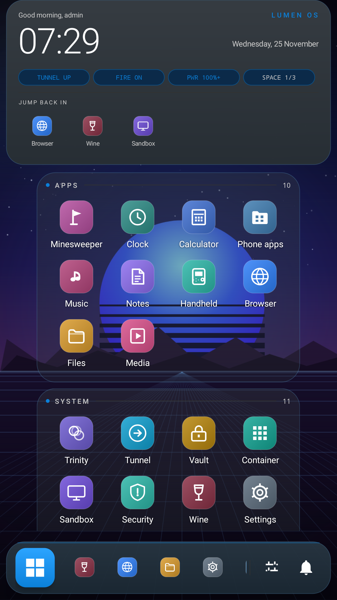
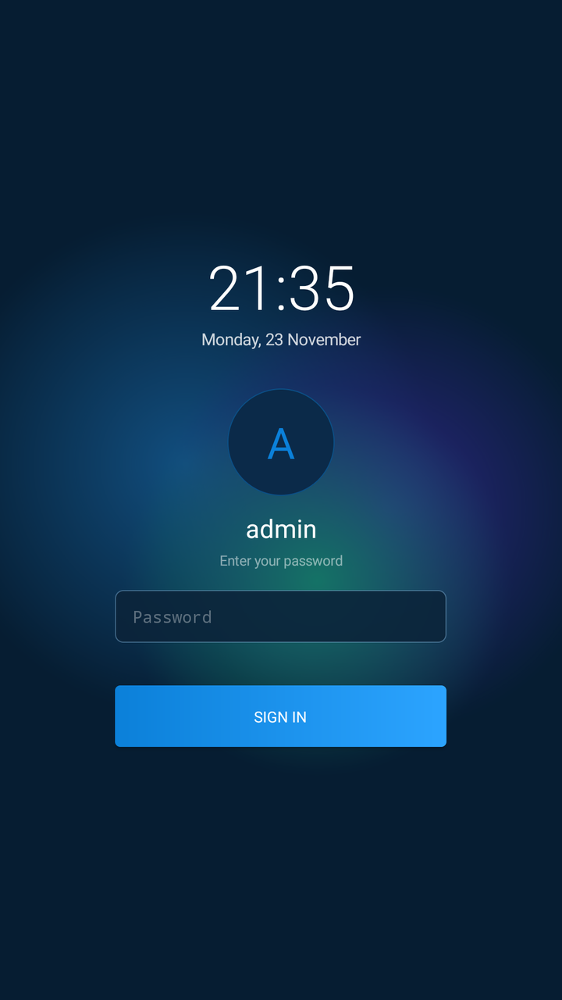
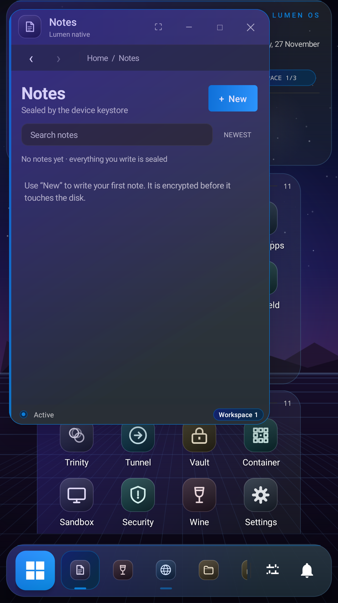
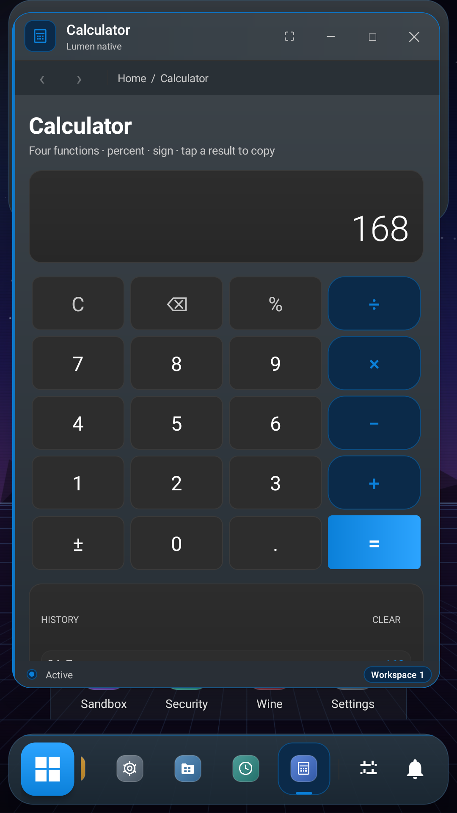
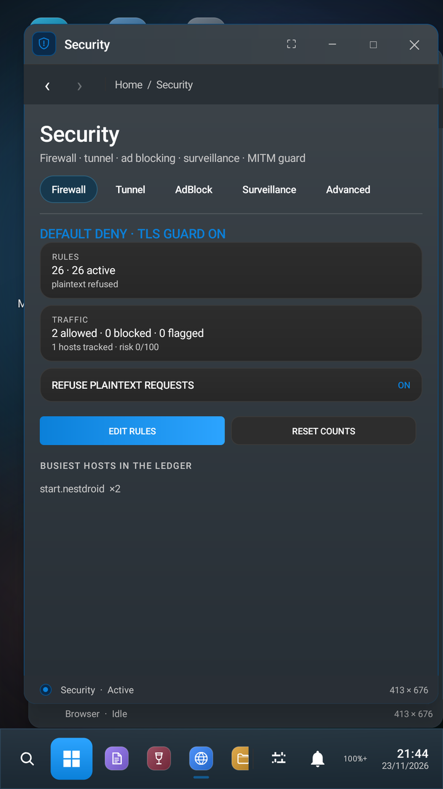
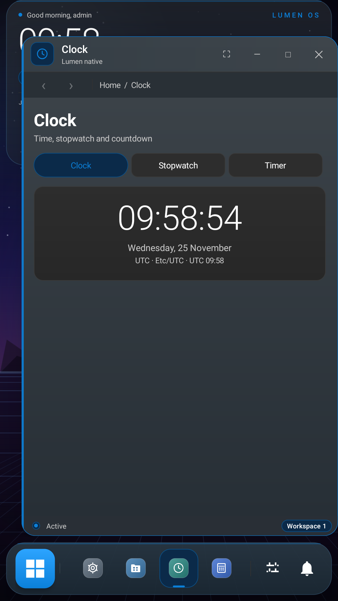
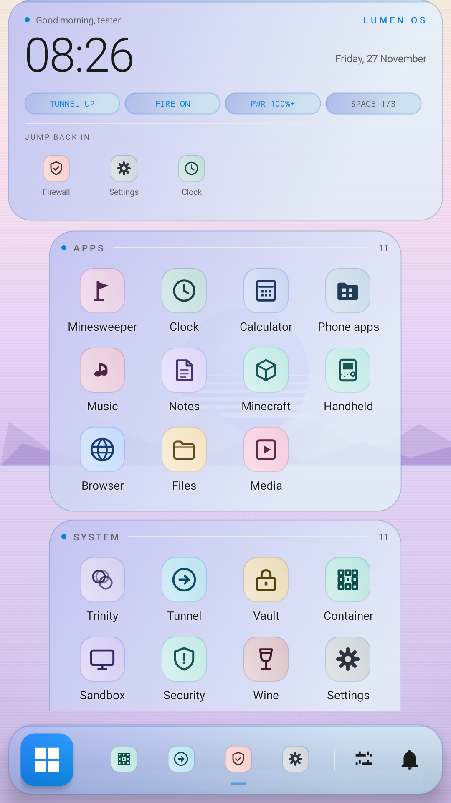

# NestDroid releases

Signed release builds of **NestDroid**, an Android sandbox + encrypted tunnel with a Lumen OS
desktop shell, an app container, an encrypted vault, a firewall and a strict no-log policy.

**This repository contains only release binaries and screenshots.** No source code, build scripts
or mapping files are published here. Every download below is a finished, signed APK.



## Screenshots

The Lumen OS shell: a Windows 11-style desktop, Start menu, floating windows, built-in apps and
light/dark themes. Everything runs on the device.

| | |
| --- | --- |
|  |  |
| **Lock screen** — local admin account, clock and quick unlock. | **Start menu** — pinned apps, recents and quick settings. |
|  |  |
| **Notes** — sealed note editor; everything is encrypted before it touches disk. | **Calculator** — themed keypad, history and tap-to-copy results. |
|  |  |
| **Browser** — offline start page, content blocker and tunnel status. | **Security** — firewall, TLS guard, traffic ledger and surveillance. |
|  |  |
| **Settings, dark** — appearance, wallpaper, desktop and taskbar. | **Settings, light** — the same theme controls in light mode. |
|  |  |
| **Clock** — time, stopwatch and countdown timer. | **Desktop, light** — the bloom wallpaper follows the accent. |

## Download

Latest release: **NestDroid 1.6.89**. Get it either way — both files are the same signed build:

- **In this repository:** [`nestdroid-1.6.89.apk`](nestdroid-1.6.89.apk)
- **From Releases:** [`nestdroid-1.6.89.apk`](https://github.com/Tripartitus/nestdroid-releases/releases/download/v1.6.89/nestdroid-1.6.89.apk)
- **Release page:** [NestDroid 1.6.89](https://github.com/Tripartitus/nestdroid-releases/releases/tag/v1.6.89)

| Version | APK | SHA-256 | Size |
| --- | --- | --- | --- |
| 1.6.89 | `nestdroid-1.6.89.apk` | `2f176e648c053a847d135fb45f6aede58d929791c68103eb04c1159f0d8d5c63` | 9,783,204 bytes |

Verify a download before installing:

```sh
sha256sum nestdroid-1.6.89.apk
```

## Install

1. Allow installs from this source on the device (Android will offer it the first time).
2. Open the APK and confirm the install. NestDroid targets API 28 and runs on Android 8.0 and newer.
3. On first launch, create the local administrator account. It stays on the device; nothing is
   registered online.

## What the release build is

- **Signed release variant:** R8-obfuscated app classes, shrunk resources, `android:debuggable="false"`
  in the merged manifest. Debug builds are never uploaded.
- **No logging:** log call sites are stripped at build time and a compile-time switch pins the no-log
  policy to strict, whatever the Settings toggle says. The diagnostics export is disabled in this build.
- **Persistent sessions:** browser cookies (site logins), encrypted downloads, imported Wine programs
  and handheld battery saves survive restarts, locking and shutdown.
- **A real reset:** Sandbox → RESET erases the account, vault, cookies, preferences, caches and the
  guest snapshot, then closes the app — the next launch is a fresh install.

## Notes

- The container is built on BCore (Apache-2.0); its license notice is bundled in the app.
- NestDroid is local-only: no analytics, no accounts on a server, no telemetry.
- These APKs are signed with a development certificate; verify the checksum above, and only install
  builds published on this page.
