# NestDroid releases

Signed release builds of **NestDroid**, an Android sandbox + encrypted tunnel with a Lumen OS
desktop shell, an app container, an encrypted vault, a firewall and a strict no-log policy.

**Latest: NestDroid 1.9.1** — [download the APK](nestdroid-1.9.1.apk) ·
[release notes](https://github.com/Tripartitus/nestdroid-releases/releases/tag/v1.9.1) ·
SHA-256 `5b38a0a824d5bba72da9bdceb178d9a76e6e12ddfe3d1d1ea388e44ddfa5e4bb`

**This repository contains only release binaries and screenshots.** No source code, build scripts
or mapping files are published here. Every download is a finished, signed APK.


## What's inside

- **Lumen OS desktop** — a thumb-first shell: a skylight hero with the clock and telemetry in the
  viewing area, a scrolling launch deck and floating dock in the thumb zone, a Start bottom sheet
  with thumb-zone search, a radial long-press quick menu, floating windows and light/dark themes.
- **Horizon wallpaper** — a procedural retro-futurist dawn (banded sun, perspective grid, star
  field, scanlines) that follows the accent, with Bloom, Midnight and Aurora presets.
- **Built-in apps** — Files, Notes, Media, Terminal, Browser, Vault, Calculator, Clock and Minesweeper.
- **Sandbox and container** — isolated guest engine, virtual APK space, sealed file imports.
- **Wine and handheld** — Windows-program runtime and Game Boy / DS emulation.
- **Security** — encrypted vault, firewall, traffic monitor, TLS guard and a strict no-log policy.
- **WireGuard tunnel** — WARP or imported configs, with host-mediated egress.

## Screenshots

All screenshots are from the 1.9.1 release build.

### Desktop and shell

| | |
| --- | --- |
|  |  |
| **Lock screen** — local admin account, clock and one-tap unlock. | **Desktop, dark** — skylight hero, launch deck and floating dock. |

| | |
| --- | --- |
| 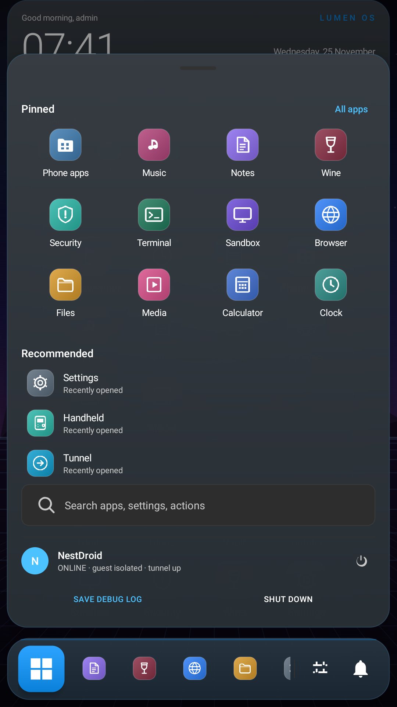 | 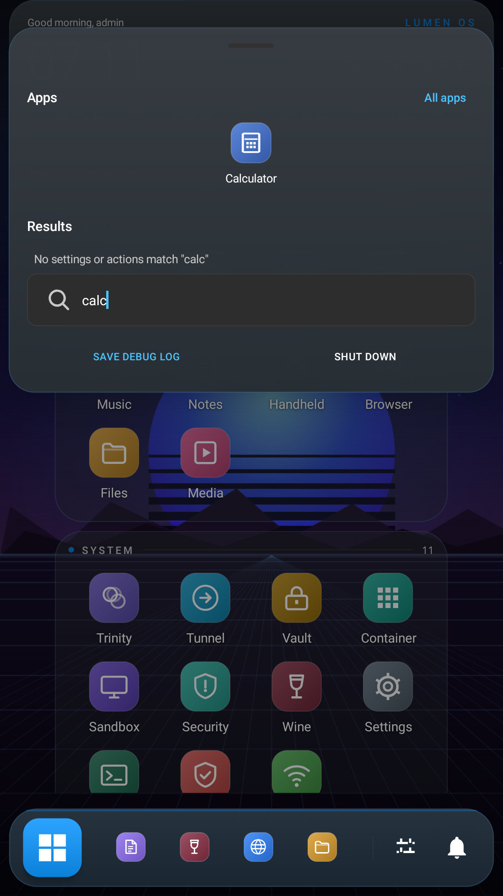 |
| **Start menu** — a bottom sheet: pinned grid, recents, search in the thumb zone. | **Search** — apps stay visible under an Apps header, above settings and actions. |

| | |
| --- | --- |
| 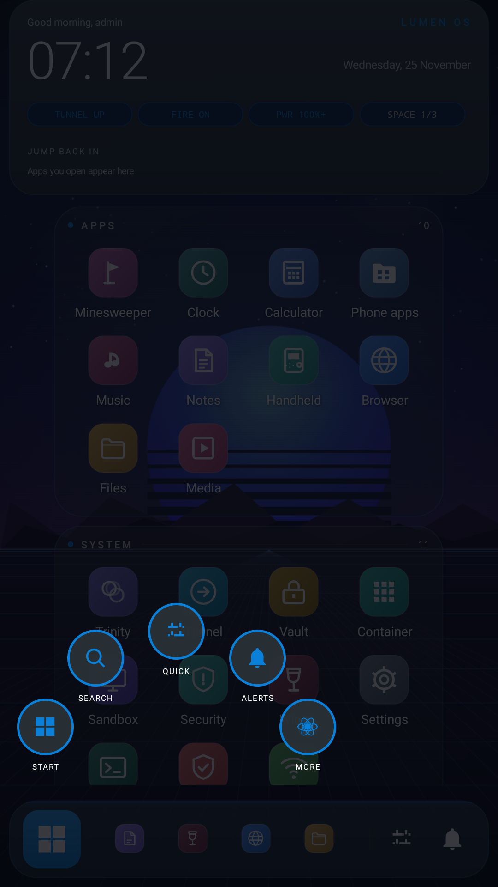 | 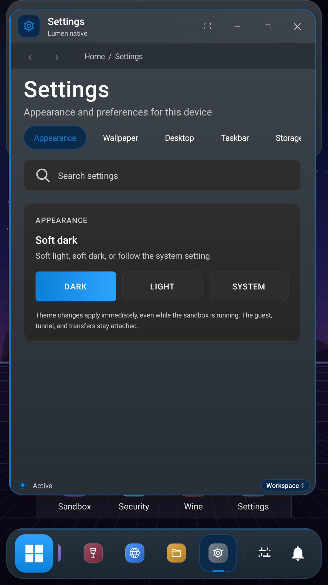 |
| **Lumen Ring** — long-press the wallpaper or Start for five radial targets. | **Settings** — appearance, wallpaper, desktop and dock. |

Light theme keeps the same layout over a pale dawn:

| | |
| --- | --- |
|  | 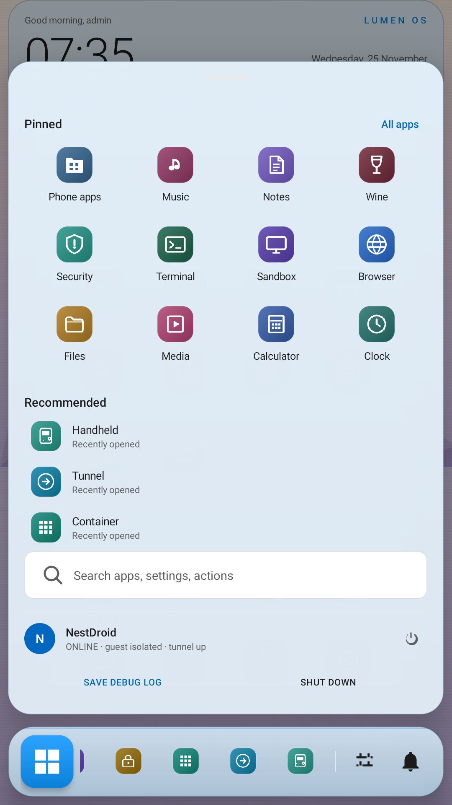 |
| **Desktop, light** — the Horizon wallpaper follows the accent. | **Start menu, light** — the same sheet in light mode. |

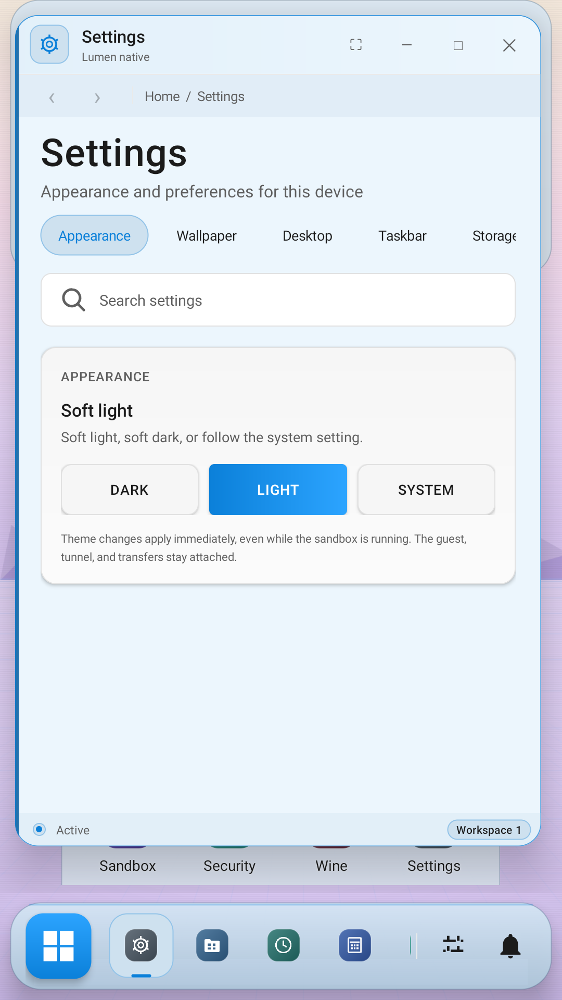

The animated rainbow accent can cycle the interface, the wallpaper, or both. Chrome surfaces read
the hue at draw time, so the dock, launch boards, hero chips, quick tiles and window frames move
together:

| | |
| --- | --- |
| 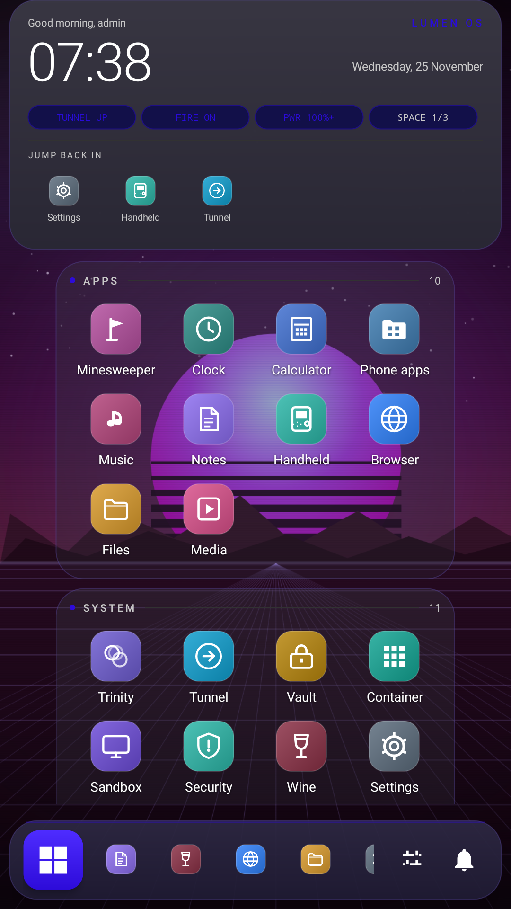 | 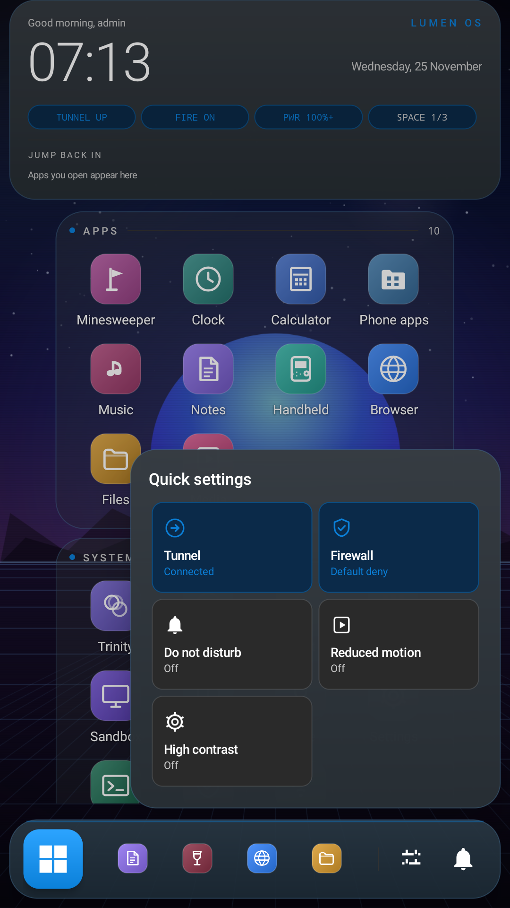 |
| **Rainbow accent** — the shell and the wallpaper follow one wheel. | **Quick settings** — on tiles carry the live accent; off tiles stay neutral. |

### Built-in apps

Windows use the 1.9.1 caption bar: app mark, name and runtime, then full screen, minimize,
maximize and close, with the workspace pill on the status strip.

| | |
| --- | --- |
| 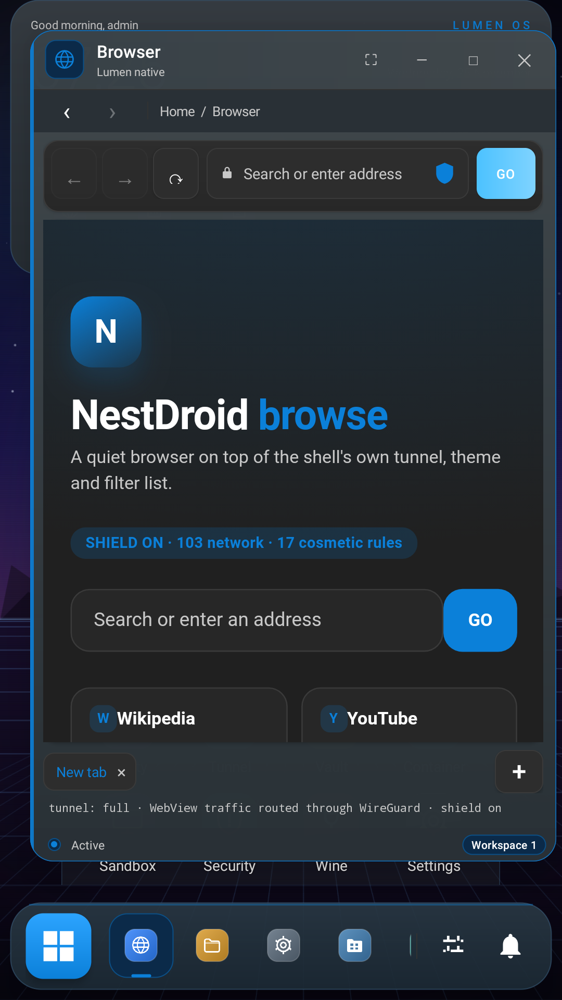 |  |
| **Browser** — secure address pill, content blocker and offline start page. | **Notes** — sealed editor; notes are encrypted before they touch disk. |
|  | 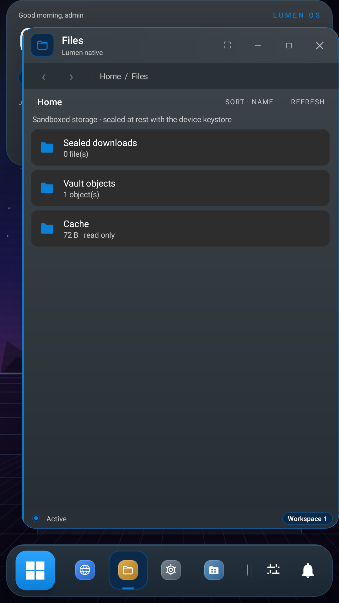 |
| **Calculator** — themed keypad, history and tap-to-copy results. | **Files** — sealed downloads and vault objects in one browser. |

### Security and storage

| | |
| --- | --- |
|  | 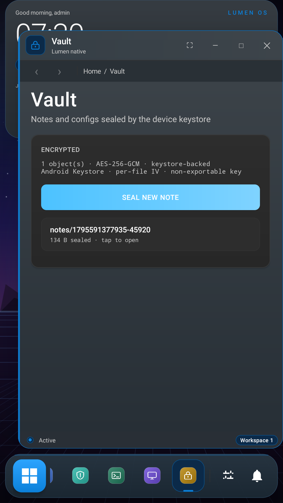 |
| **Security** — firewall, TLS guard, traffic ledger and surveillance tools. | **Vault** — AES-256-GCM objects sealed by the device keystore. |
|  | 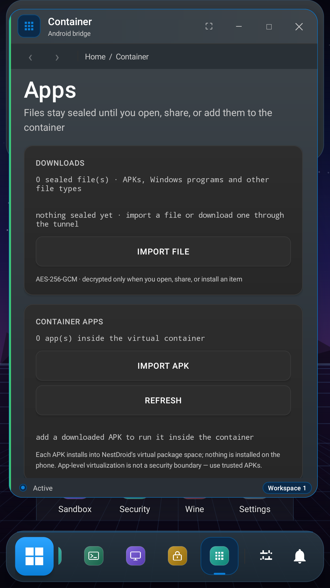 |
| **Clock** — clock, stopwatch and countdown timer. | **Container** — virtual package space and encrypted file imports. |

### Sandbox, Wine and handheld

| | |
| --- | --- |
| 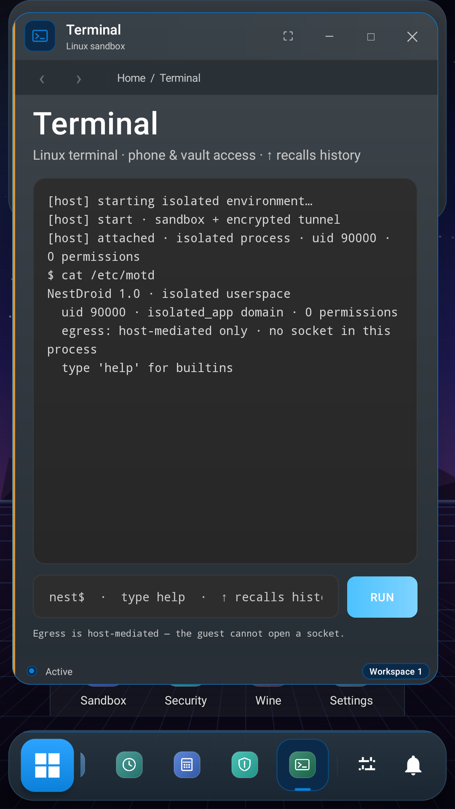 | 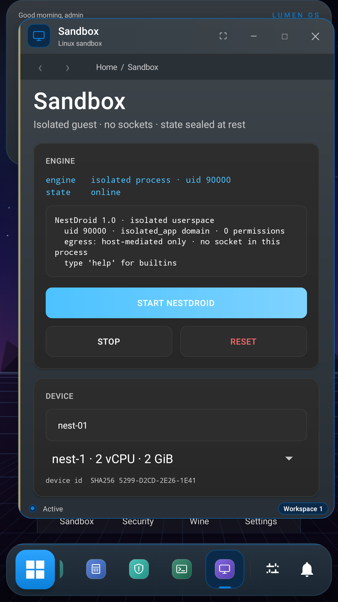 |
| **Terminal** — Linux-style console inside the isolated guest. | **Sandbox** — engine status, virtual device and reset controls. |
| 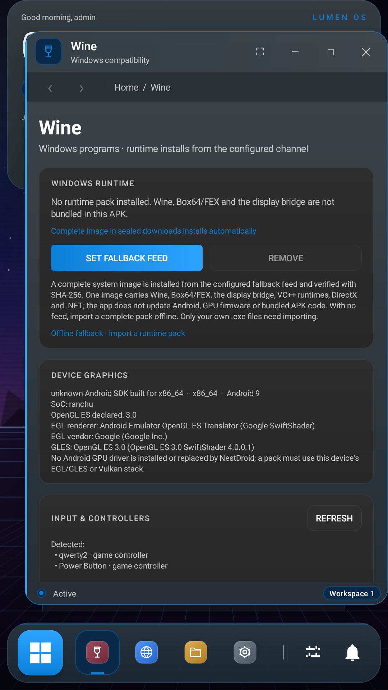 | 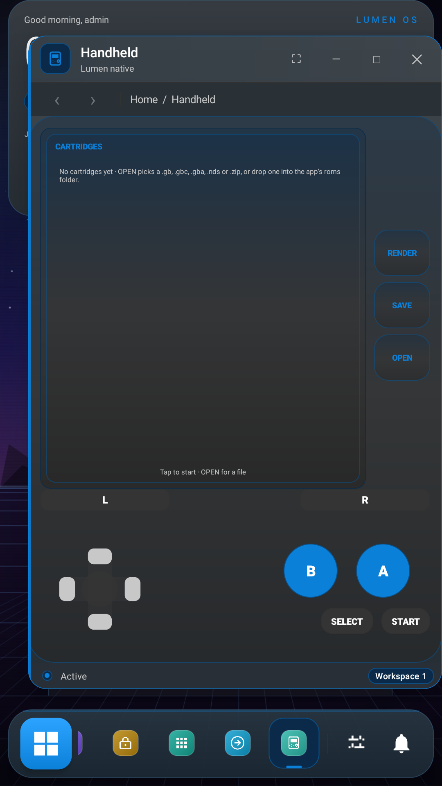 |
| **Wine** — Windows runtime channel, graphics and controller diagnostics. | **Handheld** — Game Boy / DS emulator with on-screen controls. |

### Network

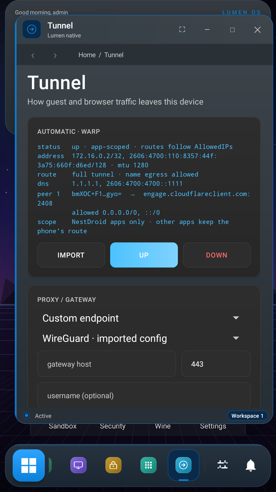

**Tunnel** — WireGuard / WARP status and custom gateway.

## Download

**NestDroid 1.9.1** is available in this repository and on the Releases page — both are the same
signed build:

- **In this repository:** [`nestdroid-1.9.1.apk`](nestdroid-1.9.1.apk)
- **From Releases:** [`nestdroid-1.9.1.apk`](https://github.com/Tripartitus/nestdroid-releases/releases/download/v1.9.1/nestdroid-1.9.1.apk)
- **Release page:** [NestDroid 1.9.1](https://github.com/Tripartitus/nestdroid-releases/releases/tag/v1.9.1)

| Version | APK | SHA-256 | Size |
| --- | --- | --- | --- |
| 1.9.1 | `nestdroid-1.9.1.apk` | `5b38a0a824d5bba72da9bdceb178d9a76e6e12ddfe3d1d1ea388e44ddfa5e4bb` | 9,807,512 bytes |
| 1.6.89 | `nestdroid-1.6.89.apk` | `2f176e648c053a847d135fb45f6aede58d929791c68103eb04c1159f0d8d5c63` | 9,783,204 bytes |

Verify the download before installing:

```sh
sha256sum nestdroid-1.9.1.apk
```

## Install

1. Allow installs from this source on the device (Android will offer it the first time).
2. Open the APK and confirm the install. NestDroid targets API 28 and runs on Android 8.0 and newer.
3. On first launch, create the local administrator account. It stays on the device; nothing is
   registered online.

## What the release build is

- **Signed release variant:** R8-obfuscated app classes, shrunk resources, `android:debuggable="false"`
  in the merged manifest. Debug builds are never uploaded.
- **No logging:** log call sites are stripped at build time and a compile-time switch pins the no-log
  policy to strict, whatever the Settings toggle says. The diagnostics export is disabled in this build.
- **Persistent sessions:** browser cookies (site logins), encrypted downloads, imported Wine programs
  and handheld battery saves survive restarts, locking and shutdown.
- **A real reset:** Sandbox → RESET erases the account, vault, cookies, preferences, caches and the
  guest snapshot, then closes the app — the next launch is a fresh install.

## Notes

- The container is built on BCore (Apache-2.0); its license notice is bundled in the app.
- NestDroid is local-only: no analytics, no accounts on a server, no telemetry.
- These APKs are signed with a development certificate; verify the checksum above, and only install
  builds published on this page.
